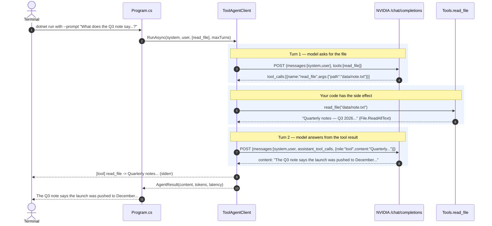

# Day 4 — Your first tool-calling agent

*Part of [**The Architect's Hour**](../../) — learning to build AI into applications,
one hour a day. Thu 03 Sep 2026.*

The model decides when to reach for the world and when to just answer.

Give the model **one function** it can call — `read_file(path)`, a real filesystem read —
and nothing else. Ask a question whose answer lives in `data/note.txt`, and the model
*chooses* to call `read_file`, gets the file back, and answers from it. Ask "what is 2+2?"
and it answers directly, never touching the tool. **The model, not you, decides each turn
whether it needs the file or can answer on its own.**

That decision is made possible by a hand-built **agentic loop** — no framework, no SDK,
just raw HTTP and a loop: send `messages` + a `tools` array, the model replies with
`tool_calls`, you execute each one and feed the result back as a `tool`-role message, and
repeat until the model answers. The loop is the primitive every agent is built from.

## What's in the code

Three source files, 312 lines including comments, plus the bundled note.

| File | What it does |
|---|---|
| `ToolAgentClient.cs` | The new thing: an OpenAI-compatible loop that POSTs `messages`+`tools`, parses `tool_calls`, appends tool results, and repeats |
| `Tools.cs` | The one tool: `read_file` (JSON schema + dispatcher) |
| `Program.cs` | System prompt, CLI, runs the loop and prints the answer |
| `data/note.txt` | A bundled file the model can be asked about |

## Setup

Same secret store as D1-D3:

```bash
# Already set from D1-D3
dotnet user-secrets set "NVIDIA_API_KEY" "your-key-here"
```

## Run it

```bash
cd week1/04-tool-calling-agent

# The tool success path — answer lives in the file
dotnet run -- --prompt "What does the Q3 note say about the product launch and headcount?"

# The no-tool path — model can answer directly
dotnet run -- --prompt "What is 2 + 2?"

# Pipe a question on stdin
echo "Is headcount frozen?" | dotnet run

# See the full wire (requests + responses)
dotnet run -- --raw --prompt "What is the Frankfurt data center's go-live date?"
```

**Flags:**

| Flag | Default | What it does |
|---|---|---|
| `--prompt` | *(stdin)* | Question to answer |
| `--max-turns` | `8` | Cap on agent loop iterations |
| `--raw` | off | Echo request/response bodies to stderr |

The answer goes to stdout. The `[tool] ...` trace and `--raw` bodies go to stderr, so
`dotnet run -- --prompt "..." > answer.txt` captures the answer alone.

![Three runs in one terminal. The first asks what the Q3 note says about the product launch and headcount; a [tool] line shows read_file called with data/note.txt, and the model answers that the launch was pushed from October to December and headcount is frozen, at 1023 input tokens. The second asks what 2 + 2 is and answers "2 + 2 = 4." with no tool call at all, at 419 input tokens. The third pipes "Is headcount frozen?" on stdin, calls read_file again, and quotes the note back before answering yes.](assets/tool-call-and-no-tool.png)

Same app, same tools array. The model called `read_file` for the first and third questions
and skipped it entirely for the second.

## What one run actually does

A question whose answer lives in the file triggers the tool loop. A question that
doesn't is answered in one hop with no tool.

### The tool path



### The no-tool path

A direct question like "What is 2+2?" is answered in one hop with no `tool_calls`
at all — the same endpoint, the same request shape minus the tools, but the model saw
no reason to reach for the filesystem and answered `2+2 = 4` immediately.

## Concepts this day introduces

**Tool calling (function calling):** The model doesn't run code — it *describes* a call
(`{name, arguments}`) and you run it and return the result. The contract is a JSON
schema (`name`, `description`, `parameters`) you send in the `tools` array; the reply's
`finish_reason: "tool_calls"` tells you it wants a function executed, and the next
`tool`-role message you append is its observation.

**Real side effects vs in-prompt facts.** D2 retrieved context *before* calling the
model. D4 lets the *model* reach for facts *during* the conversation. The tool does
work in the outside world (reading a file, hitting an API) that retrieval alone can't.

**The model picks the arguments, so the tool is only as safe as you make it.** `read_file`
here calls `File.ReadAllText` on whatever path comes back — no allow-list, no root. Ask it
about `../../secrets.json` and it will read that too. That's deliberate for a day about the
loop, but it's the real lesson of the box: the schema is a suggestion, and the only
enforcement is the code you write on your side of the call.

**The agentic loop.** A loop over: ask the model → execute any tool calls it requested
→ feed results back → ask again. The model decides when it has enough context and when
to stop calling. This loop is the primitive every agent is built from.

## What broke (and what confirmed the fix)

- **Wrong path → clean refusal, not hallucination.** A run asked about `HR_policy.txt`.
  The tool returned `Could not find file '…/HR_policy.txt'`, and instead of inventing
  contents the model said it couldn't read the file and asked for the correct path. A tool
  error is not a failure — it's the observation the next turn reasons from.
- **No tool when not needed.** "What is 2+2?" went straight to an answer in one turn.
  The model reaches for the tool only when the prompt implies the answer lives in the
  file — the decision is the model's, not yours.
- **Running out of turns looked like an answer.** The loop first returned the string
  `(max turns reached)` as its content, so a run that never finished printed inside the
  answer fences and exited `0`. A loop that gives up has to fail like a failure: stderr,
  non-zero exit.

## Stack diagram

```
   model  →  prompt  →  retrieval  →  tools  →  agent  →  evaluation
                                        ▲         ▲
                                     you build the loop here
```

| Box | What it is |
|---|---|
| **model** | one POST, one answer, priced in tokens (D1) |
| **prompt** | what you put in the messages array, and how you version it |
| **retrieval** | filling that array with facts the model doesn't have (D2-D3) |
| **tools** | letting the model ask *you* to run something, then calling back ← **today** |
| **agent** | a loop over model and tools that decides when it's done ← **today's loop is the primitive** |
| **evaluation** | how you know it still works after you change a prompt |

---

*Design notes in [`SPEC.md`](SPEC.md).*