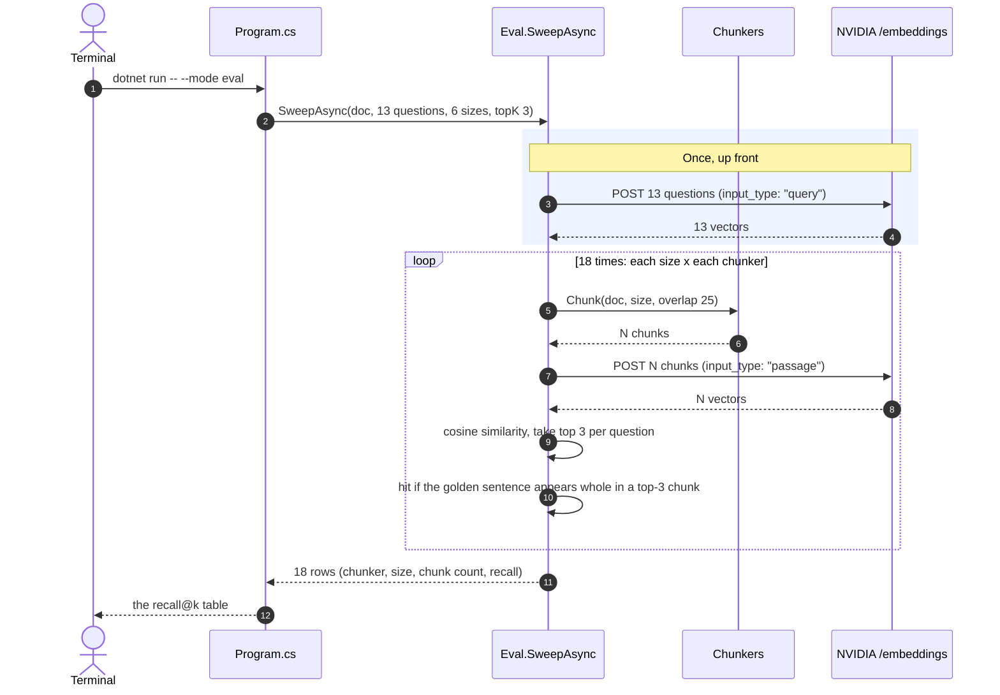

# Day 5 — Chunking Lab: the right way to chunk, with evidence

*Part of [**The Architect's Hour**](../../) — learning to build AI into applications,
one hour a day. Fri 04 Sep 2026. Follow-up to Day 2.*

How you split a document decides whether retrieval works. The size you split it into
mostly doesn't.

After D2 published, readers asked: **"Is the chunk size a fixed number? Doesn't that lose
context?"** This project answers with a measurement. It runs **three chunkers** over the
same document at **six sizes**, asks the same 13 questions each time, and reports how
often the answer landed in the top 3 retrieved chunks. Eighteen rows, one table.

The scoring trick is what makes the table fair: every question carries a **golden full
sentence** copied verbatim from the corpus, and a run counts as a hit only if that whole
sentence survives inside a retrieved chunk. A chunker that cuts sentences in half can
never score, at any size, by construction.

## What's in the code

Three source files, 270 lines including comments, plus the corpus and the question set.

| File | What it does |
|---|---|
| `Chunkers.cs` | The new thing: `SemanticChunker` keeps whole paragraphs, and hands an oversized paragraph to D2's sentence chunker |
| `Eval.cs` | The measurement: embed the questions once, then chunk / embed / score for each chunker and size |
| `Program.cs` | CLI: `eval` / `chunk` / `answer` modes |
| `data/corpus.txt` | An employee handbook, 27 paragraphs, facts kept local so retrieval is testable |
| `data/eval-questions.tsv` | 13 questions, each with the exact sentence the answer must come from |

Only the semantic chunker and the eval are new. The other two chunkers are the previous
days' real code, referenced not copied: D2's sentence-aware **word** chunker and D3's
naive **char** chunker.

## Setup

Same secret store as D1-D4:

```bash
# Already set from D1-D4
dotnet user-secrets set "NVIDIA_API_KEY" "your-key-here"
```

## Run it

```bash
cd week1/05-chunking-lab

# The money command: sweep 3 chunkers x 6 sizes, print recall@k
dotnet run -- --mode eval

# See what a chunker actually produces at a size
dotnet run -- --mode chunk --chunker semantic --size 250

# See the shredded chunks behind the 0% row
dotnet run -- --mode chunk --chunker char --size 10

# End-to-end spot check: retrieve + chat
dotnet run -- --mode answer --query "What is the annual learning budget and what can it be spent on?"
```

**Flags:**

| Flag | Default | What it does |
|---|---|---|
| `--mode` | `eval` | `eval` (table), `chunk` (show chunks), `answer` (retrieve+chat) |
| `--doc` | `data/corpus.txt` | Document to search |
| `--questions` | `data/eval-questions.tsv` | The eval question set |
| `--sizes` | `10,20,50,100,250,500` | Chunk sizes to sweep |
| `--chunker` | `semantic` | `word`, `semantic`, or `char` (for `chunk`/`answer`) |
| `--size` | `250` | Chunk size in words (for `chunk`/`answer`) |
| `--overlap` | `25` | Words carried into the next chunk (for `chunk`/`answer`) |
| `--top-k` | `3` | Chunks retrieved per question |

`--size` is a word budget. The `char` chunker takes it as characters at ~6 chars/word,
the same mapping the sweep uses, so `--mode chunk` at a given size shows you exactly the
chunks behind that row of the table.

## The result

Live run, NVIDIA embeddings, 13 questions, top-k 3:

```
chunker    size  chunks  recall@k
----------------------------------
word         10      75   100%
semantic     10      76   100%
char         10     179     0%
word         20      46   100%
semantic     20      51   100%
char         20      66    23%
word         50      41   100%
semantic     50      28   100%
char         50      23    76%
word        100      14   100%
semantic    100      27   100%
char        100      11   100%
word        250       5   100%
semantic    250      27   100%
char        250       5   100%
word        500       3   100%
semantic    500      27   100%
char        500       3   100%
```

![Three runs in one terminal. The first is dotnet run --mode eval, printing the eighteen-row recall@k table: word and semantic score 100% at every size from 10 to 500, while char scores 0% at size 10 (179 chunks), 23% at 20, 76% at 50, and 100% from 100 up. The second is --mode chunk --chunker char --size 10, showing 179 chunks whose text is visibly shredded mid-word: "[1] e. This handbook collects the rules and benefits every emplo". The third is --mode answer, which retrieves chunks 11, 23 and 2 and answers that the annual learning budget is one thousand dollars per employee, spendable on courses, books or conference tickets but not hardware, using 249 input tokens.](assets/eval-sweep.png)

Chunk `[1]` in the middle panel is the failure in one line: it starts `e. This handbook`
because the cut landed inside the word "Acme". That is what a 0% row looks like up close.

**The `char` column is the whole lesson.** D3's naive character-count chunker cuts at a
fixed offset regardless of where sentences end: **0% at 10, 23% at 20, 76% at 50**. By 100
the chunks are large enough to hold whole sentences by accident, and it recovers.

**But say what the 0% is.** At `--size 10` the char chunker gets a 60-character budget,
and every golden sentence is longer than that. The answer does not exist whole *anywhere*
in the index, so no search could have scored above zero. This is not a ranking failure
that a bigger top-k or a better embedding model would rescue. The answer was destroyed
before retrieval ran.

**`word` and `semantic` hold 100% on every row.** Both respect sentence boundaries, so
every chunk contains whole sentences and the golden always survives somewhere. Note that
this means the new semantic chunker does not beat D2's existing one on this corpus. It
ties it, and that tie is the finding.

**`--size` is a ceiling, not a target.** A sentence longer than the budget is emitted
whole rather than cut, so at `--size 10` the average chunk is 13.9 words for `word` and
13.7 for `semantic`. Below sentence length the number stops doing anything at all.

**Shrink k and the tie starts to break.** `--top-k 1` is the harder test, and it is where
paragraph awareness earns something: at size 250, `word` drops to 92% while `semantic`
holds 100%. Keep it in proportion, though. With 13 questions one flip is 7.7 points, so
that gap is a single question, and at size 10 both fall to 92% together. The honest
summary is that the semantic chunker is never worse and is occasionally better when
you can only afford one chunk.

```bash
dotnet run -- --mode eval --top-k 1     # word 250 -> 92%, semantic 250 -> 100%
```

**Chunk shape shows up in your token bill.** Asking the same question through `answer`
mode costs 984 input tokens with `word` at size 250 and 248 with `semantic`, because
semantic returns three tight paragraphs where word returns three fifth-of-the-document
slabs. Same answer, 4x the context.

### So what size should you pick?

1. **Fix the chunker before the number.** Splitting on sentence and paragraph boundaries
   removes most context loss for free.
2. **Then treat size as forgiving.** From ~50 to ~500 words you are tuning for embedding
   input limits and question granularity, not fighting sentence shattering.
3. **Too large still costs you, just not in recall.** The whole handbook in 3 chunks
   retrieves "everything". The answer is in there, and so is everything else, which a
   recall@k table cannot show you.

## What one run actually does

`--mode eval` embeds the 13 questions once, then walks the grid. Questions do not depend
on chunk size, so re-embedding them 18 times would be 18x the cost for identical vectors.



## Concepts this day introduces

**recall@k.** Of the questions you asked, what fraction had their answer inside the top k
retrieved chunks. It needs no LLM and no vector DB, just cosine similarity and a substring
check, which makes it cheap enough to run on every change. This is the first taste of the
evaluation box.

**Chunk-size-agnostic ground truth.** The golden is a *full sentence*, not a clause, so
the same question set scores any chunker at any size fairly. Size your ground truth to the
meaning unit you actually want retrieved, or the eval will pass while the pipeline is
broken.

**Meaning-aware chunking.** Boundaries should follow meaning (paragraphs, then sentences),
not a running count. A paragraph is already a coherent unit; a character offset is not.

**The sentence splitter is the weak link, and it is 9 lines.** `SplitSentences` splits on
`.!?` and re-appends a `.`, so a golden ending in `?` would never match and any
abbreviation or decimal number shatters a sentence. The handbook corpus avoids both on
purpose. A real corpus needs a real splitter, and that is its own day. The eval is only
ever as honest as the crudest thing under it.

## What broke

- **My first corpus was too small to discriminate.** D2's 1,140-word sample collapsed to
  2–34 chunks, so top-k=3 found every answer at every size (flat 87%). Switching to a
  27-paragraph handbook where answers are local made the differences visible.
- **D2's "word" chunker was already sentence-aware.** I expected it to shatter at small
  sizes; it doesn't — the real breakage lives in naive char-count chunking (D3). That
  reframe is the actual lesson, and it cost me the day I planned.
- **Short golden substrings hid the problem.** Single clauses (~8–12 words) survive even
  char splitting; only *whole-sentence* goldens expose the failure.

## Stack diagram

```
   model  →  prompt  →  retrieval  →  tools  →  agent  →  evaluation
                            ▲                                 ▲
                      you are here                 (this box, first taste)
```

| Box | What it is |
|---|---|
| **model** | one POST, one answer, priced in tokens (D1) |
| **prompt** | what you put in the messages array, and how you version it |
| **retrieval** | filling that array with facts the model doesn't have (D2-D3) ← **today, measured** |
| **tools** | letting the model ask *you* to run something, then calling back (D4) |
| **agent** | a loop over model and tools that decides when it's done |
| **evaluation** | how you know it still works after you change a prompt ← **today: recall@k** |

---

*Design notes in [`SPEC.md`](SPEC.md).*
